# SchemeSetu

**Find the Indian government schemes you're entitled to, by talking to an AI in English, हिंदी or Hinglish.**

SchemeSetu ("setu" means bridge) helps people discover central government schemes such as scholarships, internships, pensions, housing, health cover and business loans. You describe your situation in your own words, typed or spoken. Generative AI understands you, a deterministic rules engine checks each scheme's eligibility rules, and every result shows the rule and official source behind it.

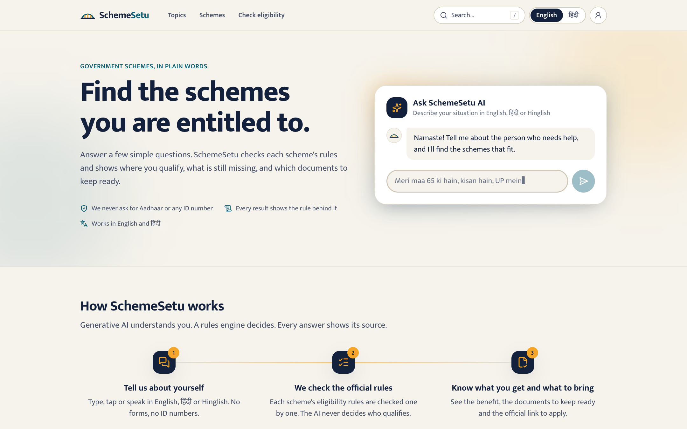

> **Prototype.** The rules for all 30 schemes are simplified from public sources and **not yet verified** against the latest official guidelines. Always confirm on the official website before applying.

## Highlights

- **AI assistant, text or voice.** Chat naturally ("meri maa 65 ki hain, kisan hain, UP mein"), or switch to **voice mode**: it listens, answers aloud, then listens again, like ChatGPT's voice mode.
- **The AI never decides eligibility.** The language model only turns messages into structured facts and writes replies. A rules engine makes every eligibility decision, and code-level guards stop the model from inventing dates, amounts or schemes.
- **Explainable results.** Every scheme shows *why*: each condition, the user's answer, the rule text and the official link, plus the documents to keep ready.
- **The fewest questions possible.** The step-by-step check always asks the question that settles the most schemes next.
- **30 schemes in 9 topics.** Students & youth (scholarships, PM Internship, NATS, education loans), farmers, women, seniors, jobs, business and startups, housing, health and pensions.
- **Search in any language.** "naukri", "kisan" and "छात्रवृत्ति" all work, from the header search box, or with **/** or **⌘K** on any page.
- **Bilingual.** The full interface is in English and Hindi, at `/en/…` and `/hi/…`.
- **No sign-up needed.** Everything works without an account. An optional account (phone OTP, or username and password) saves answers across devices and sends a WhatsApp alert when a newly added scheme matches them.
- **Private by design.** It never asks for Aadhaar or any ID number; the data model has no field for one, so it's dropped even if typed. Users can delete their account and data.

## Screenshots

| AI assistant (Hinglish, live model) | Voice mode |
|---|---|
| 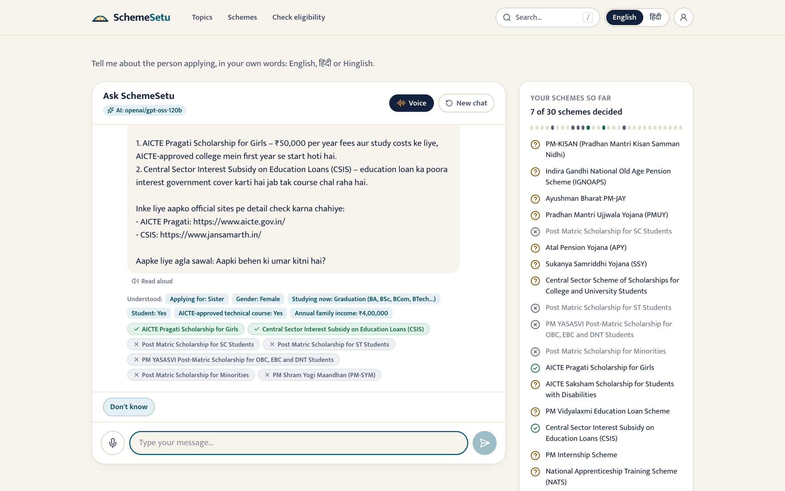 | 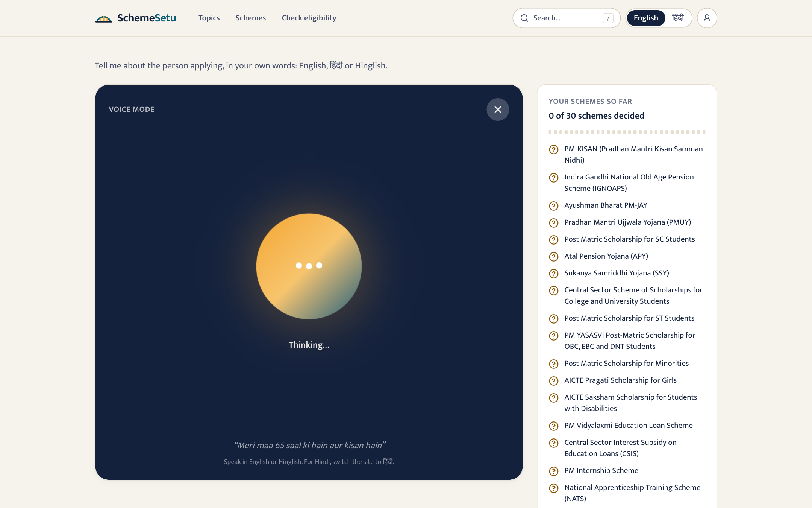 |
| **Explainable eligibility results** | **Topics → schemes by type** |
| 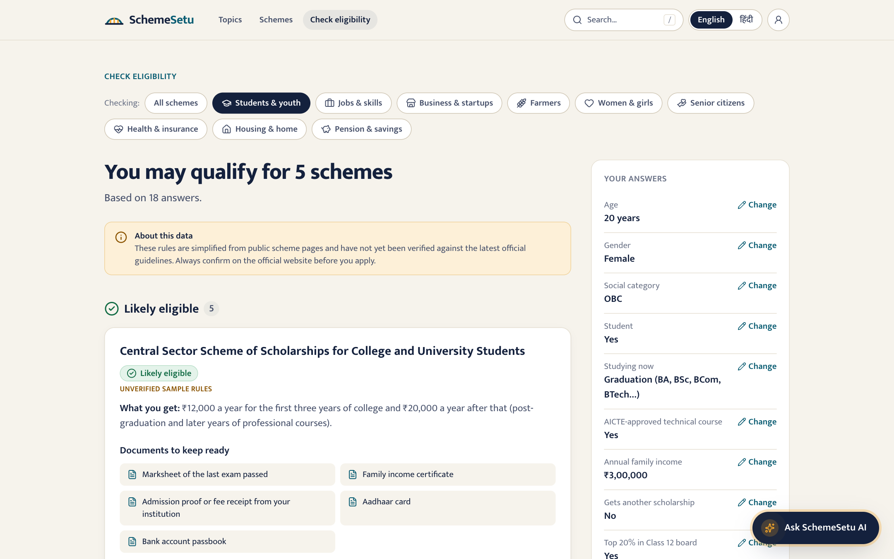 | 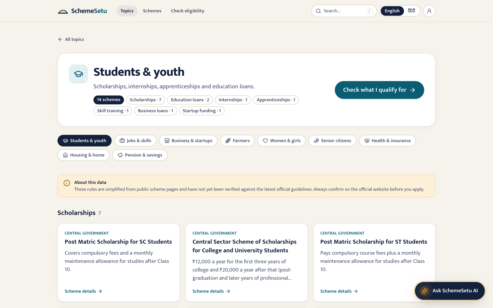 |
| **How it works** | **Search (English, Hindi, Hinglish)** |
| 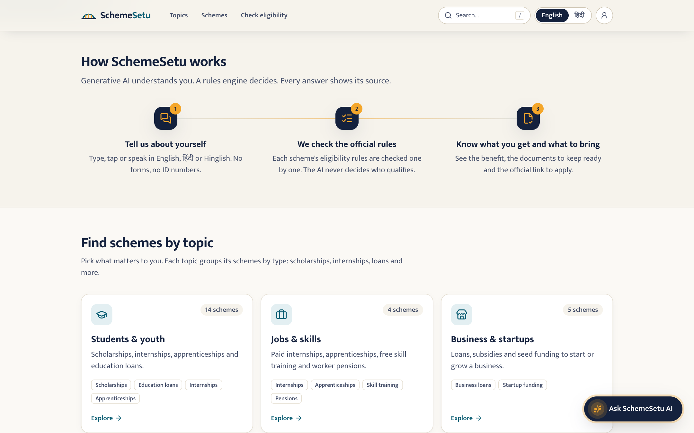 | 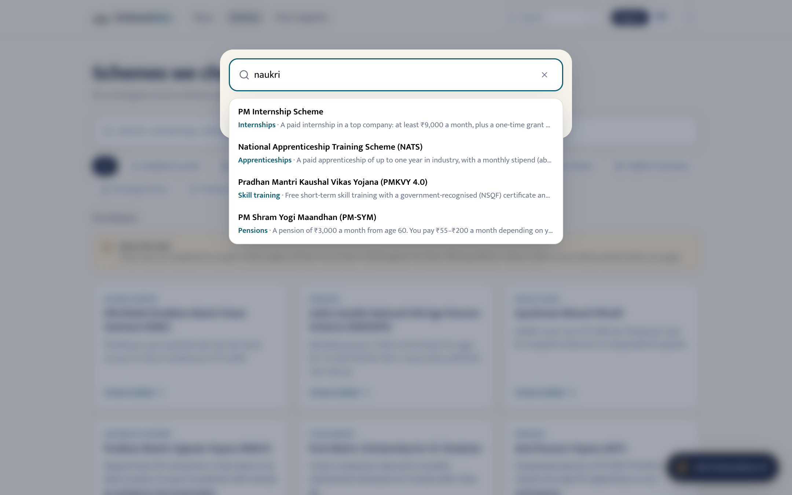 |
| **Optional login: phone OTP or username & password** | **Account: saved answers and WhatsApp alerts** |
| 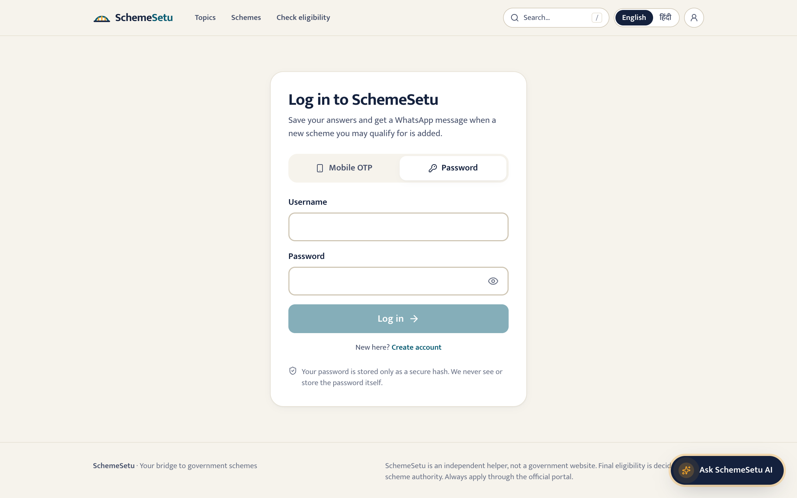 | 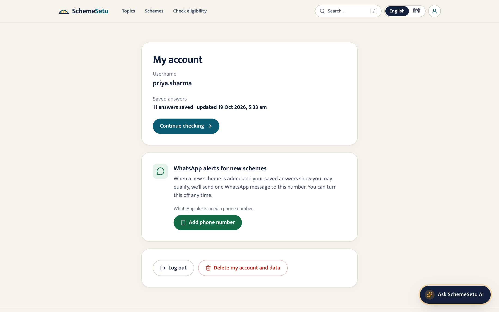 |

<p align="center">
  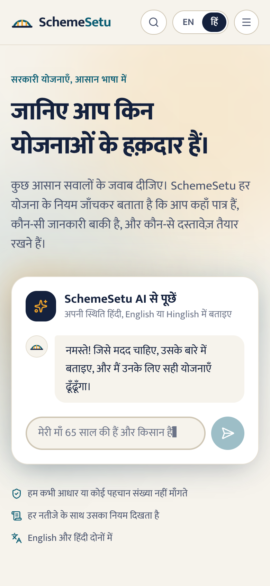
  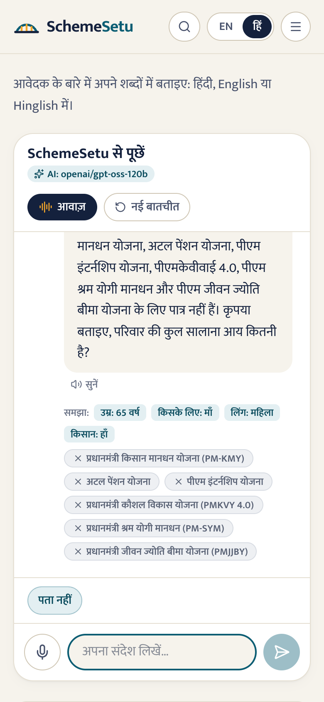
  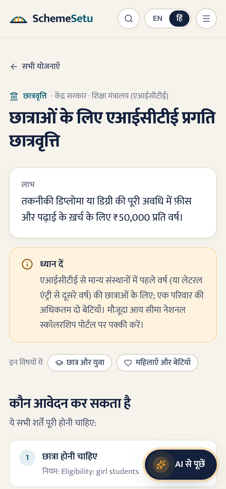
</p>

## How the AI is used, safely

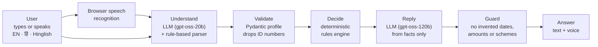

1. **Understand.** An LLM turns free text into profile fields. A rule-based Hinglish/Hindi parser runs alongside it, covers simple answers like "haan" (yes) or "2.5 lakh" without spending AI quota, and keeps working if the AI is unavailable.
2. **Validate.** Every field passes the `Profile` model. Unknown keys, including any ID number, are dropped.
3. **Decide.** The rules engine evaluates each scheme as *likely eligible*, *not eligible* or *needs info*, and picks the next most useful question.
4. **Reply.** The LLM writes a short, friendly answer from those facts only. General questions ("BPL card kaise banwate hain?", "how do I get a BPL card?") are answered from a vetted glossary where one exists.
5. **Guard.** If a scheme answer mentions a month, year or ₹ amount that isn't in the scheme data, it's replaced with a template answer built from the data.

## Architecture

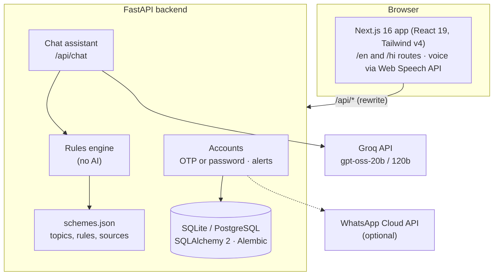

## Tech stack

| Layer | Tools |
|---|---|
| Frontend | Next.js 16 (App Router, Cache Components, partial prerendering), React 19, TypeScript, Tailwind CSS v4, lucide icons |
| Backend | Python 3.13, FastAPI, Pydantic v2, SQLAlchemy 2, Alembic migrations |
| Accounts | Phone OTP (HMAC-hashed codes, rate limits) or username + password (scrypt hashes, lockout after 5 failed tries); HttpOnly session cookie |
| AI | Groq free tier (OpenAI-compatible): `openai/gpt-oss-20b` for understanding, `openai/gpt-oss-120b` for replies. Swappable for Ollama or OpenAI |
| Voice | Browser Web Speech API: speech recognition and synthesis (Hindi and Indian English) |
| Data | 30 central schemes with bilingual text, rules and official sources (`backend/app/data/schemes.json`) |

## Quality

- **185 backend tests:** rules engine, API, OTP and password login, database migrations, alerts, chat, and AI guardrails, with the model mocked.
- **Eligibility eval:** 29 hand-labelled personas, **143 of 143** (scheme, persona) pairs right (`python -m eval.run_eval`).
- **Understanding eval:** 25 labelled English, Hindi and Hinglish messages. The rule-based parser gets **22 of 22** standard cases; the live model is scored with `--llm`.
- **Browser tests:** every flow in Chrome and in WebKit (Safari's engine), desktop and phone.

## Run it locally

**Backend** (Python 3.13):

```sh
cd backend
python3 -m venv .venv && .venv/bin/pip install -r requirements.txt
cp .env.example .env        # optional: add GROQ_API_KEY for the AI assistant
.venv/bin/uvicorn app.api:app --reload --port 8000
```

The API creates and upgrades its database on startup (SQLite by default; set `DATABASE_URL` for PostgreSQL). After changing a model in `app/db.py`, generate a migration with `.venv/bin/alembic revision --autogenerate -m "describe the change"`.

**Frontend** (Node 22):

```sh
cd frontend
npm install
npm run dev                 # http://localhost:3000
```

If the API isn't on port 8000, put `BACKEND_URL=http://127.0.0.1:<port>` in `frontend/.env.local`.

Without a `GROQ_API_KEY`, the assistant runs in **basic mode** with the built-in parser. A free key comes from [console.groq.com](https://console.groq.com/keys). Username and password login works out of the box. To test phone login without SMS or WhatsApp, set a fictional number in `backend/.env`: `OTP_TEST_NUMBERS=9999999999:123456`. Codes are never shown in the app.

**Checks:**

```sh
cd backend && .venv/bin/python -m pytest && .venv/bin/python -m eval.run_eval && .venv/bin/python -m eval.run_chat_eval
cd ../frontend && npx eslint . && npx tsc --noEmit && npm run build
```

**New-scheme alerts:** after adding schemes to `schemes.json`, run `.venv/bin/python -m app.notify` (add `--dry-run` to preview).

## Project structure

```
backend/
  app/
    services/rules_engine.py   eligibility logic (no AI)
    ai/assistant.py            chat: understand → validate → decide → reply → guard
    ai/fallback.py             rule-based English/Hindi/Hinglish parser and glossary
    ai/llm.py                  OpenAI-compatible client (Groq by default)
    accounts.py, notify.py     OTP and password login, saved answers, WhatsApp alerts
    db.py                      SQLAlchemy models
    data/schemes.json          topics and schemes (bilingual, cited)
  migrations/                  Alembic migrations (applied on startup)
  eval/                        labelled personas and chat messages
  tests/
frontend/
  src/app/[lang]/              pages: home, topics, schemes, check, assistant, login, account
  src/components/assistant/    chat, voice mode, home-page AI box
  src/components/checker/      step-by-step eligibility check
  src/lib/                     API client, i18n, search, speech
docs/screenshots/
```

## Roadmap

- Verify every scheme's rules against official guidelines, and add state schemes.
- Real OTP and alert delivery over SMS or WhatsApp (needs a provider account).
- Public deployment with PostgreSQL.
- More Indian languages, and Hindi translations of rule citations.

## Disclaimer

SchemeSetu is an independent helper, not a government website. Final eligibility is decided by the scheme authority, so always apply through the official portal.

---

Built by [@Hardikk1508](https://github.com/Hardikk1508).
